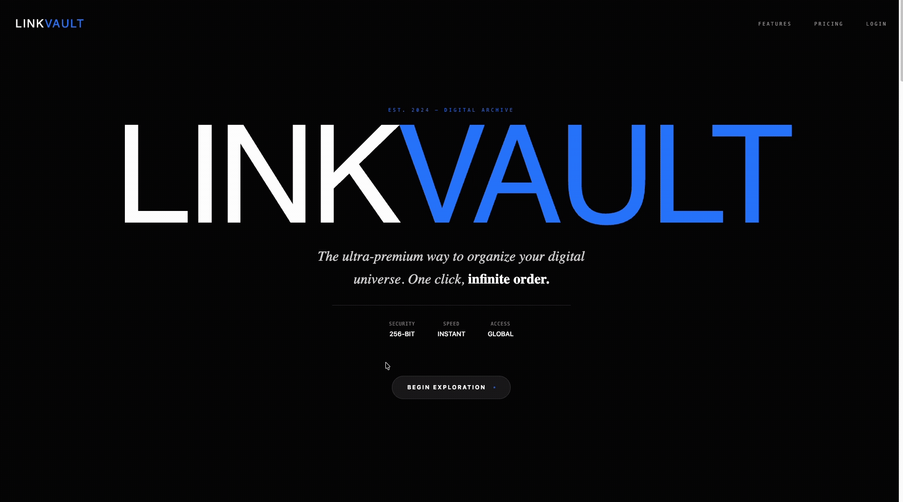

<p align="center">
  
</p>

<h1 align="center">LinkVault</h1>

<p align="center">
  A premium 3D landing page for organizing, syncing, and sharing saved links and browser tabs.
</p>

<p align="center">
  
  
  
  
  
</p>

<p align="center">
  <a href="#overview">Overview</a>
  ·
  <a href="#getting-started">Getting Started</a>
  ·
  <a href="#project-structure">Project Structure</a>
  ·
  <a href="#deployment">Deployment</a>
</p>

## Overview

LinkVault is a scroll-driven React experience that presents a digital archive concept through 3D folder and link-card animations. The page combines a full-screen Three.js scene with HTML content rendered through React Three Fiber and a separate animated feature section.

The experience includes:

- A dark, premium visual system with custom display and serif typography
- A Three.js folder model and floating link cards
- Scroll-based movement, rotation, scaling, and card placement
- A progress indicator synchronized with the scroll position
- Six rotating product features with clickable selection
- Responsive hero, product-story, metrics, and call-to-action sections
- Motion transitions powered by Motion and React Three Fiber

## Tech stack

- **React 19 + TypeScript** — application composition and type-safe components
- **Vite 6** — development server and production builds
- **Three.js** — 3D rendering and materials
- **React Three Fiber** — React bindings for the Three.js scene
- **Drei** — cameras, text, environment lighting, scroll controls, and shadows
- **Cannon and React Three Cannon** — available 3D physics dependencies
- **Motion** — feature transitions and interaction animation
- **Tailwind CSS** — utility-based layout and styling
- **Lucide React** — feature icons

## Requirements

- Node.js (an active LTS release)
- npm
- A browser with WebGL support

## Getting started

### 1. Install dependencies

```bash
npm install
```

### 2. Start the development server

```bash
npm run dev
```

The project runs on port `3000` and is available at `http://localhost:3000`.

### 3. Create a production build

```bash
npm run build
```

The optimized output is generated in `dist/`.

### 4. Preview the production build

```bash
npm run preview
```

## Available scripts

| Command | Description |
| --- | --- |
| `npm run dev` | Start Vite on port 3000 with host access enabled |
| `npm run build` | Build the production bundle |
| `npm run preview` | Preview the production bundle locally |
| `npm run lint` | Run the TypeScript compiler without emitting files |
| `npm run clean` | Remove the `dist/` directory |

## Project structure

```text
.
├── public/                         # Optional static assets
├── src/
│   ├── components/
│   │   ├── FeaturesSection.tsx     # Animated feature selector
│   │   ├── Models.tsx              # Folder and link-card 3D models
│   │   └── Scene.tsx               # Canvas, scroll scene, and page sections
│   ├── constants.ts                # Folder and link-card content
│   ├── App.tsx                     # Application shell and navigation
│   ├── index.css                   # Fonts, theme tokens, and global styles
│   └── main.tsx                    # React entry point
├── index.html                      # HTML shell and metadata
├── package.json                    # Scripts and dependencies
├── tsconfig.json                   # TypeScript configuration
└── vite.config.ts                  # Vite and Tailwind configuration
```

## Page experience

1. **Hero** — LinkVault positioning, archive metrics, and exploration prompt
2. **Feature wheel** — six product capabilities with automatic and manual selection
3. **The Extension** — browser extension positioning and capture workflow
4. **The Drop** — animated explanation of sorting links into vaults
5. **Call to action** — product invitation and supporting metrics

## Customization

### Product content

Update [`src/constants.ts`](src/constants.ts) to change the sample folders and link cards shown in the 3D scene. Update [`src/components/Scene.tsx`](src/components/Scene.tsx) for page copy, navigation labels, metrics, and call-to-action text.

### 3D presentation

The folder and link-card geometry is defined in [`src/components/Models.tsx`](src/components/Models.tsx). Camera position, lighting, scroll timing, object placement, and HTML overlay sections are managed in [`src/components/Scene.tsx`](src/components/Scene.tsx).

### Visual system

Global colors, fonts, glass effects, and gradient utilities are defined in [`src/index.css`](src/index.css). The page currently uses Google Fonts loaded from CSS.

## Current integration notes

- This repository contains a front-end concept only; there is no persistence, authentication, browser extension, or backend integration.
- Navigation and product actions use placeholder `#` links or visual buttons.
- Folder and link data is static and stored in `src/constants.ts`.
- The Gemini environment variable is exposed by the Vite configuration template but is not used by the current UI.
- WebGL performance depends on the device and browser. The canvas uses a device-pixel-ratio range of 1–2.

## Quality checks

```bash
npm run lint
npm run build
```

## Deployment

LinkVault is a static Vite application and can be deployed to Vercel, Netlify, GitHub Pages, or any static web server.

| Setting | Value |
| --- | --- |
| Install command | `npm install` |
| Build command | `npm run build` |
| Output directory | `dist` |

If deploying under a subpath, configure the Vite `base` option in [`vite.config.ts`](vite.config.ts).

## License

No license has been declared for this project yet. Add a `LICENSE` file before distributing it as open-source software.
